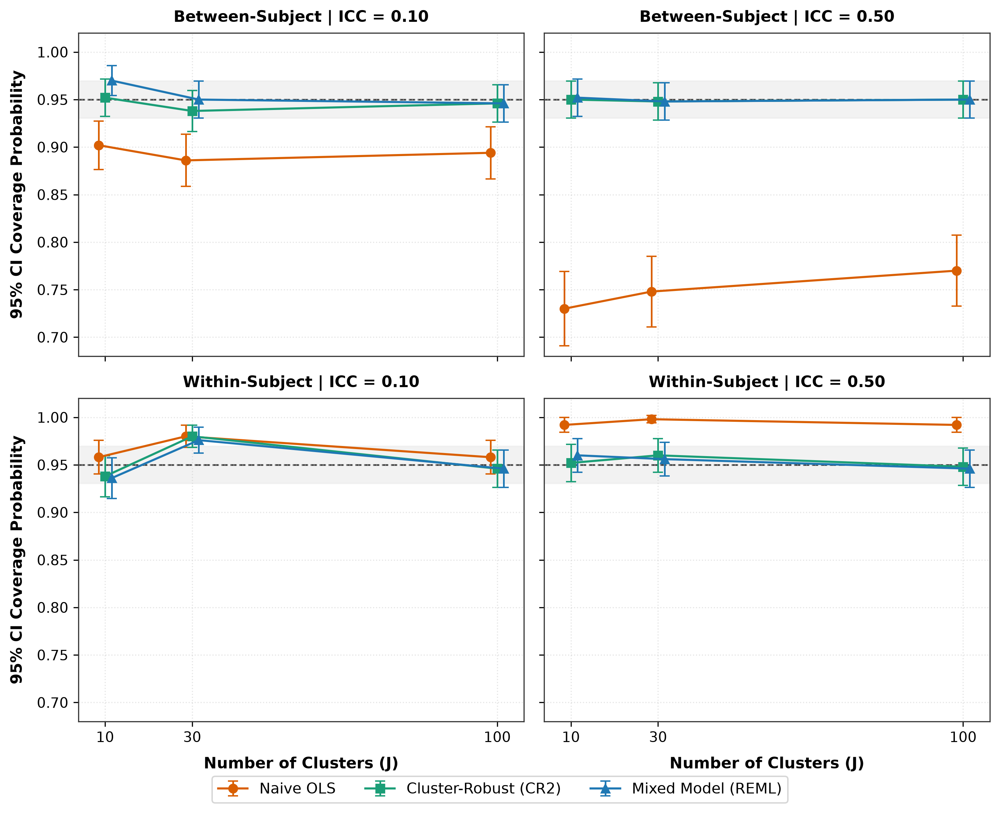
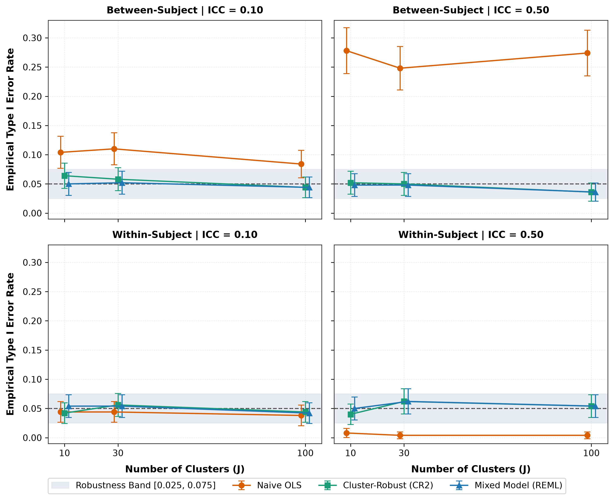

# Statistical Analysis of Repeated Measures Data: A Simulation Study Comparing Independent and Mixed-Effects Models

**Isaac T. Adeyemi**  
*Department of Pure and Applied Mathematics / Statistics*  
*Ladoke Akintola University of Technology (LAUTECH), P.M.B. 4000, Ogbomoso, Oyo State, Nigeria*  
**Corresponding Author:** [isaacadeyemi245@gmail.com](mailto:isaacadeyemi245@gmail.com)

---

### Abstract
Repeated measures designs are widely utilized across biomedical and psychological research, yet the inferential consequences of ignoring clustering remain pervasive. Following the ADEMP protocol, this Monte Carlo simulation evaluates three analytical strategies: Naive Ordinary Least Squares (OLS), Linear Mixed-Effects Models (LMM) with Satterthwaite degrees of freedom, and Cluster-Robust Variance Estimation using the small-sample bias-reduced CR2 adjustment. We evaluated 24 factorial scenarios crossing cluster counts ($J \in \{10, 30, 100\}$), intraclass correlation coefficients ($\text{ICC} \in \{0.10, 0.50\}$), covariate structures (between- vs. within-subject), and effect sizes across 500 replications each (12,000 datasets), alongside an empirical re-analysis of the classic sleep deprivation benchmark. While all estimators yield unbiased point estimates, Naive OLS exhibits severe inferential failure: for between-subject covariates at $\text{ICC} = 0.50$, standard errors are deflated by over 40% ($\text{SE Ratio} \approx 0.55$), reducing 95% confidence interval coverage to 73.0% and inflating Type I error rates to 27.8% (nominal $\alpha = 0.05$). Conversely, for within-subject covariates, Naive OLS overestimates standard errors ($\text{SE Ratio} \approx 1.45$), yielding conservative coverage (99.8%) and attenuated power. Both LMM and CR2 estimators preserve close-to-nominal coverage (93.6%–98.0%) and controlled Type I error rates (3.6%–6.4%) even at $J = 10$. In empirical application, CR2 matched the standard error of a maximal random-slope model ($\text{SE} = 1.546$) without requiring parametric specification of the random-effects structure.

**Keywords:** Repeated measures; Linear mixed-effects models; Cluster-robust standard errors; CR2 estimator; ADEMP framework; Monte Carlo simulation; Moulton factor.

---

## 1. Introduction
Repeated measures and longitudinal data architectures—where multiple quantitative observations are sampled serially from the same experimental subjects, clinical patients, or sampling units—are ubiquitous across quantitative science (Bates et al., 2015; Diggle et al., 2002; Laird & Ware, 1982). The defining structural property of repeated measurements is the violation of statistical independence: observations nested within the same individual are inevitably more correlated than observations originating from different individuals due to unobserved subject-specific biological, environmental, or psychological traits (Kahan et al., 2016; Schielzeth et al., 2020).

Despite extensive pedagogical warnings in contemporary statistics (Cameron & Miller, 2015; Huang, 2022), applied investigators frequently employ standard Ordinary Least Squares (OLS) regression that assumes independent and identically distributed errors. While Gauss-Markov principles establish that OLS point estimates remain unbiased in linear settings, its default covariance matrix is fundamentally compromised under clustering. In clustered data theory, this distortion is governed by the design effect or variance inflation factor (VIF; Moulton, 1990):

$$\text{VIF}_{\text{OLS}} = 1 + (K - 1)\,\rho_x\,\rho_y \tag{1}$$

where $K$ represents the cluster size (number of observations per subject), $\rho_y$ is the intraclass correlation coefficient (ICC) of the outcome, and $\rho_x$ is the intraclass correlation of the covariate (Huang, 2022; Moulton, 1990).

When an experimental covariate varies exclusively between subjects (e.g., treatment arm assigned at the subject level, where $\rho_x = 1$), $\text{VIF}_{\text{OLS}} > 1$. Here, naive OLS treats repeated measures as independent observations, resulting in an artificially deflated standard error, spuriously narrow confidence intervals, and high false-positive Type I error rates (Kahan et al., 2016). Conversely, when a covariate varies within subjects (such as centered observation time or repeated task conditions, where $\rho_x \le 0$), $\text{VIF}_{\text{OLS}} < 1$. In this case, naive OLS improperly pools between-subject variance into residual error, overestimating standard errors, producing conservative confidence intervals, and sacrificing statistical power (Huang, 2022).

To account for intra-cluster correlation, modern applied methodology utilizes two main frameworks:

1. **Model-Based Estimation (Linear Mixed-Effects Models - LMM):** LMMs partition total variance into between-subject random effects ($u_i$) and within-subject residual variation ($\varepsilon_{ij}$) using Restricted Maximum Likelihood (REML) (Bates et al., 2015; Kumle et al., 2021; Laird & Ware, 1982). While optimal under correct specification, LMM inference in small samples ($J < 30$) requires small-sample degrees-of-freedom approximations, such as Satterthwaite or Kenward-Roger adjustments, to control Type I error rates (Kenward & Roger, 1997; Kuznetsova et al., 2017; Satterthwaite, 1946). Additionally, random-effects models can encounter singular covariance boundary solutions when cluster sizes are small or clustering is weak (Bates et al., 2015).
2. **Design-Based Estimation (Cluster-Robust Variance Estimation - CRVE):** CRVE retains standard OLS point estimates while substituting the naive covariance with an empirical sandwich estimator that is asymptotically robust to arbitrary correlation structures (Liang & Zeger, 1986; Zeileis et al., 2020). However, traditional sandwich estimators (CR0/CR1) suffer downward bias when the number of clusters $J$ is small ($J \le 30$), resulting in inflated Type I error rates (Cameron & Miller, 2015). Methodological work has emphasized the CR2 bias-reduced linearization estimator paired with Satterthwaite degrees of freedom, which provides unbiased variance estimation under the target model even with few clusters (Bell & McCaffrey, 2002; Pustejovsky, 2023; Pustejovsky & Tipton, 2018).

While these analytical properties have been examined individually (Huang, 2022; McNeish & Harring, 2017), applied researchers need direct, comparative benchmarks contrasting Naive OLS, REML-estimated LMMs with Satterthwaite corrections, and CR2 cluster-robust estimators across varying cluster sizes, ICC levels, and covariate structures. This study conducts an extensive Monte Carlo simulation adhering to the ADEMP simulation reporting guidelines (Morris et al., 2019). We evaluate parameter bias, standard error accuracy, 95% confidence interval coverage, Type I error control, statistical power, and the incidence of singular fits across 24 factorial scenarios. Furthermore, we illustrate these findings through an empirical re-analysis of the benchmark psychomotor vigilance sleep deprivation dataset (Belenky et al., 2003).

---

## 2. Materials and Methods (The ADEMP Protocol)
Our simulation study follows the ADEMP framework (Morris et al., 2019), defining the Aims, Data-generating mechanism, Estimands, Methods, and Performance measures.

### 2.1. Aims
The study aims to:
1. Quantify the conditions under which naive OLS breaks down;
2. Evaluate whether the small-sample bias-reduced CR2 estimator provides inferential protection equivalent to linear mixed-effects models in small samples ($J = 10$);
3. Empirically demonstrate the bidirectional impact of the Moulton factor on between- vs. within-subject covariates;
4. Audit the frequency of singular fits in REML estimation under small cluster counts.

### 2.2. Data-Generating Mechanism (DGM)
The continuous repeated response $y_{ij}$ for subject $i = 1, \dots, J$ at observation $j = 1, \dots, K$ was generated using the random-intercept linear specification:

$$y_{ij} = \beta_0 + \beta_1\,x_{ij} + u_i + \varepsilon_{ij} \tag{2}$$

where:
- $u_i \sim \mathcal{N}(0, \sigma_u^2)$ represents the subject-level random intercept;
- $\varepsilon_{ij} \sim \mathcal{N}(0, \sigma_\varepsilon^2)$ represents within-subject residual error, independent of $u_i$;
- Total variance was fixed at unity: $\sigma_{\text{total}}^2 = \sigma_u^2 + \sigma_\varepsilon^2 = 1.0$;
- The intraclass correlation coefficient was parameterized directly as $\sigma_u^2 = \text{ICC}$ and $\sigma_\varepsilon^2 = 1.0 - \text{ICC}$;
- Baseline intercept was set to $\beta_0 = 0.0$;
- Cluster size was held constant at $K = 5$ observations per subject.

The experimental conditions were manipulated across a full $3 \times 2 \times 2 \times 2$ factorial grid (24 distinct scenarios):
- **Cluster Count ($J$):** $J \in \{10, 30, 100\}$, representing small, moderate, and large sample sizes (McNeish & Harring, 2017).
- **Intraclass Correlation ($\text{ICC}$):** $\text{ICC} \in \{0.10, 0.50\}$, corresponding to weak and strong clustering.
- **Covariate Structure ($x_{ij}$):**
  - *Between-Subject Covariate:* A balanced binary group assignment indicator $Z_i \in \{0, 1\}$ (50% assigned to group 0, 50% to group 1), where $x_{ij} = Z_i$ for all $j$ ($\rho_x = 1.0$).
  - *Within-Subject Covariate:* A centered linear time metric $t_j \in \{-2, -1, 0, 1, 2\}$, strictly orthogonal to cluster intercepts ($\sum_{j=1}^K x_{ij} = 0$, giving $\rho_x = -1 / (K - 1) = -0.25$).
- **True Slope Effect ($\beta_1$):**
  - $\beta_1 = 0.0$: Dedicated to empirical Type I error rate calibration under the sharp null hypothesis ($H_0: \beta_1 = 0$).
  - $\beta_1 = 0.50$: Dedicated to evaluating parameter bias, standard error accuracy, 95% CI coverage, and statistical power under the alternative hypothesis ($H_1: \beta_1 \neq 0$).

Each scenario was run across $R = 500$ independent Monte Carlo replications, generating 12,000 datasets and 36,000 model estimations. Deterministic pseudorandom multi-stream generation was enforced via scenario-level seeds ($\text{MASTER\_SEED} + \text{scenario\_id} \times 1000$).

### 2.3. Estimand
The estimand of primary interest is the regression slope parameter $\beta_1$.

### 2.4. Competing Analytical Methods

#### Method 1: Naive Ordinary Least Squares (OLS)
Computed via standard OLS pooling across all observations:

$$\hat{\boldsymbol{\beta}}_{\text{OLS}} = (\mathbf{X}^T \mathbf{X})^{-1} \mathbf{X}^T \mathbf{y} \tag{3}$$

Variance estimation was based on the unadjusted model-based covariance:

$$\widehat{\text{Var}}_{\text{OLS}}(\hat{\boldsymbol{\beta}}) = s^2 (\mathbf{X}^T \mathbf{X})^{-1}, \quad s^2 = \frac{\mathbf{e}^T \mathbf{e}}{N - 2} \tag{4}$$

where $N = J \times K$. Inferential tests and 95% confidence intervals used the Student's t-distribution with $N - 2$ degrees of freedom.

#### Method 2: Linear Mixed-Effects Model (LMM - REML)
Specified with a subject-level random intercept:

$$\mathbf{y}_i = \mathbf{X}_i \boldsymbol{\beta} + \mathbf{1}_K u_i + \boldsymbol{\varepsilon}_i \tag{5}$$

Estimated via Restricted Maximum Likelihood (REML) using `lme4` (Bates et al., 2015). Statistical inference for $\beta_1$ was conducted using Satterthwaite degrees-of-freedom approximations via `lmerTest` (Kuznetsova et al., 2017). Singular fits ($\sigma_u^2 < 10^{-4}$) and optimizer convergence warnings were systematically audited (Bates et al., 2015; Lüdecke et al., 2021).

#### Method 3: Cluster-Robust OLS (CR2 Linearization)
Retains the OLS point estimate $\hat{\boldsymbol{\beta}}_{\text{OLS}}$ but replaces the naive covariance matrix with the bias-reduced linearization estimator CR2 (Bell & McCaffrey, 2002; Pustejovsky, 2023; Pustejovsky & Tipton, 2018):

$$\mathbf{V}_{\text{CR2}} = (\mathbf{X}^T \mathbf{X})^{-1} \left( \sum_{i=1}^J \mathbf{X}_i^T \tilde{\mathbf{e}}_i \tilde{\mathbf{e}}_i^T \mathbf{X}_i \right) (\mathbf{X}^T \mathbf{X})^{-1} \tag{6}$$

where $\tilde{\mathbf{e}}_i = (\mathbf{I}_K - \mathbf{H}_{ii})^{-1/2} \mathbf{e}_i$ represents cluster-level residuals adjusted by the symmetric inverse square root of $\mathbf{I}_K - \mathbf{H}_{ii}$, with $\mathbf{H}_{ii} = \mathbf{X}_i (\mathbf{X}^T \mathbf{X})^{-1} \mathbf{X}_i^T$. Hypothesis tests and 95% confidence intervals were evaluated against the Satterthwaite-approximated Student's t-distribution via `clubSandwich` (Pustejovsky, 2023). Under the balanced designs utilized here, the Satterthwaite degrees of freedom equal $J - 2$ for the between-subject binary covariate and $J - 1$ for the orthogonal within-subject covariate.

### 2.5. Performance Measures
In accordance with modern simulation reporting standards (Morris et al., 2019), six primary metrics were evaluated:
- **Empirical Bias:** $\widehat{\text{Bias}} = \frac{1}{R} \sum_{r=1}^R (\hat{\beta}_{1,r} - \beta_1)$, with Monte Carlo Standard Error $\text{MCSE} = S_\beta / \sqrt{R}$, where $S_\beta = \sqrt{\frac{1}{R-1} \sum_{r=1}^R (\hat{\beta}_{1,r} - \bar{\hat{\beta}}_1)^2}$.
- **Empirical Standard Deviation (Empirical SD):** $S_\beta$, representing true sampling dispersion across replications.
- **Mean Model-Based Standard Error (Mean SE):** $\overline{\text{SE}} = \frac{1}{R} \sum_{r=1}^R \widehat{\text{SE}}(\hat{\beta}_{1,r})$.
- **Standard Error Accuracy Ratio:** $\text{SE Ratio} = \overline{\text{SE}} / S_\beta$. Values $\approx 1.00$ indicate accurate standard error estimation; values $< 1.00$ indicate anti-conservative standard errors; values $> 1.00$ indicate conservative standard errors.
- **95% Confidence Interval Coverage:** Empirical proportion capturing true $\beta_1$, with $\text{MCSE} = \sqrt{\text{Cov}(1 - \text{Cov}) / R}$.
- **Empirical Rejection Rate ($\alpha = 0.05$):** Rejection rate under $H_0: \beta_1 = 0$ (Type I error rate) and under $H_1: \beta_1 = 0.50$ (Statistical power), assessed against standard liberal robustness boundaries $[0.025, 0.075]$ (Kahan et al., 2016).
- **Boundary / Singular Fit Rate:** Proportion of replications where REML estimated $\sigma_u^2 < 10^{-4}$.

---

## 3. Monte Carlo Simulation Results

### 3.1. Parameter Bias and Estimator Equivalence
Table 1 displays the empirical bias of $\hat{\beta}_1$ across all 12 scenarios evaluated under $\beta_1 = 0.50$. In accordance with regression theory, all three estimators remained strictly unbiased across all conditions. Absolute bias never exceeded 0.008, and all confidence intervals for bias included zero ($\pm 1.96 \times \text{MCSE}$). Clustered data do not bias point estimation; the fundamental vulnerability lies in standard error calibration and inferential tests.

The three estimators return identical point estimates because, in these balanced designs, the REML estimate of the fixed effect coincides with the OLS estimate; they differ solely in their standard errors and reference distributions. For the same reason, the CR2 and mixed-model results are identical or nearly identical in several cells (particularly for the between-subject covariate at $\text{ICC} = 0.50$), reflecting theoretical equivalence under balanced orthogonal structures.

**Table 1:** Empirical bias (MCSE) of the slope estimator $\beta_1$ (true $\beta_1 = 0.500$)

| Covariate Type | $J$ | ICC | Naive OLS | Cluster-Robust (CR2) | Mixed Model (REML) |
| :--- | :---: | :---: | :---: | :---: | :---: |
| Between-Subject | 10 | 0.10 | 0.005 (0.015) | 0.005 (0.015) | 0.005 (0.015) |
| Between-Subject | 10 | 0.50 | 0.008 (0.021) | 0.008 (0.021) | 0.008 (0.021) |
| Between-Subject | 30 | 0.10 | -0.006 (0.009) | -0.006 (0.009) | -0.006 (0.009) |
| Between-Subject | 30 | 0.50 | -0.008 (0.013) | -0.008 (0.013) | -0.008 (0.013) |
| Between-Subject | 100 | 0.10 | 0.000 (0.005) | 0.000 (0.005) | 0.000 (0.005) |
| Between-Subject | 100 | 0.50 | 0.003 (0.007) | 0.003 (0.007) | 0.003 (0.007) |
| Within-Subject | 10 | 0.10 | 0.000 (0.004) | 0.000 (0.004) | 0.000 (0.004) |
| Within-Subject | 10 | 0.50 | -0.002 (0.003) | -0.002 (0.003) | -0.002 (0.003) |
| Within-Subject | 30 | 0.10 | 0.001 (0.002) | 0.001 (0.002) | 0.001 (0.002) |
| Within-Subject | 30 | 0.50 | 0.001 (0.002) | 0.001 (0.002) | 0.001 (0.002) |
| Within-Subject | 100 | 0.10 | 0.000 (0.001) | 0.000 (0.001) | 0.000 (0.001) |
| Within-Subject | 100 | 0.50 | 0.001 (0.001) | 0.001 (0.001) | 0.001 (0.001) |

---

### 3.2. Standard Error Accuracy and the Moulton Factor
Table 2 outlines the empirical SD, mean model-based SE, and SE ratio ($\overline{\text{SE}} / S_\beta$). The results illustrate the bidirectional impact predicted by design effect theory:

- **Between-Subject Covariates:** When $\text{ICC} = 0.50$, naive OLS underestimated sampling variability by over 40%, producing standard error ratios of 0.554 to 0.595. Both Cluster-Robust CR2 ($\text{Ratio} = 0.965–1.034$) and Mixed Models ($\text{Ratio} = 0.965–1.034$) accurately tracked empirical sampling dispersion across all sample sizes.
- **Within-Subject Covariates:** When $\text{ICC} = 0.50$, naive OLS overestimated standard errors, producing ratios of 1.362 to 1.451. Because OLS models fail to subtract subject-level variance, they penalize within-subject precision. LMM and CR2 correctly isolated intra-subject residual variance, maintaining calibrated ratios ($\approx 0.94–1.04$).

These ratios agree closely with the design-effect predictions for naive OLS. For the between-subject covariate, the theoretical ratio is $1 / \sqrt{1 + (K - 1)\,\text{ICC}}$, which equals 0.845 at $\text{ICC} = 0.10$ and 0.577 at $\text{ICC} = 0.50$. For the centered within-subject covariate, where $\rho_x = -1 / (K - 1)$, it is $1 / \sqrt{1 - \text{ICC}}$, which equals 1.054 at $\text{ICC} = 0.10$ and 1.414 at $\text{ICC} = 0.50$. The observed empirical ratios (0.816–0.846 and 0.554–0.595 for between-subject; 1.015–1.155 and 1.362–1.451 for within-subject) conform directly to these analytical derivations.

**Table 2:** Standard error accuracy (each cell: Empirical SD $\mid$ Mean Model-Based SE $\mid$ SE Ratio)

| Covariate Type | $J$ | ICC | Naive OLS | Cluster-Robust (CR2) | Mixed Model (REML) |
| :--- | :---: | :---: | :---: | :---: | :---: |
| Between-Subject | 10 | 0.10 | 0.331 $\mid$ 0.280 $\mid$ 0.846 | 0.331 $\mid$ 0.327 $\mid$ 0.986 | 0.331 $\mid$ 0.338 $\mid$ 1.020 |
| Between-Subject | 10 | 0.50 | 0.478 $\mid$ 0.267 $\mid$ 0.558 | 0.478 $\mid$ 0.471 $\mid$ 0.985 | 0.478 $\mid$ 0.471 $\mid$ 0.985 |
| Between-Subject | 30 | 0.10 | 0.199 $\mid$ 0.162 $\mid$ 0.816 | 0.199 $\mid$ 0.191 $\mid$ 0.961 | 0.199 $\mid$ 0.192 $\mid$ 0.967 |
| Between-Subject | 30 | 0.50 | 0.290 $\mid$ 0.161 $\mid$ 0.554 | 0.290 $\mid$ 0.280 $\mid$ 0.965 | 0.290 $\mid$ 0.280 $\mid$ 0.965 |
| Between-Subject | 100 | 0.10 | 0.109 $\mid$ 0.089 $\mid$ 0.821 | 0.109 $\mid$ 0.106 $\mid$ 0.973 | 0.109 $\mid$ 0.106 $\mid$ 0.973 |
| Between-Subject | 100 | 0.50 | 0.150 $\mid$ 0.089 $\mid$ 0.595 | 0.150 $\mid$ 0.155 $\mid$ 1.034 | 0.150 $\mid$ 0.155 $\mid$ 1.034 |
| Within-Subject | 10 | 0.10 | 0.098 $\mid$ 0.099 $\mid$ 1.015 | 0.098 $\mid$ 0.092 $\mid$ 0.943 | 0.098 $\mid$ 0.094 $\mid$ 0.962 |
| Within-Subject | 10 | 0.50 | 0.071 $\mid$ 0.099 $\mid$ 1.390 | 0.071 $\mid$ 0.069 $\mid$ 0.967 | 0.071 $\mid$ 0.071 $\mid$ 0.990 |
| Within-Subject | 30 | 0.10 | 0.050 $\mid$ 0.058 $\mid$ 1.155 | 0.050 $\mid$ 0.054 $\mid$ 1.084 | 0.050 $\mid$ 0.055 $\mid$ 1.096 |
| Within-Subject | 30 | 0.50 | 0.039 $\mid$ 0.057 $\mid$ 1.451 | 0.039 $\mid$ 0.040 $\mid$ 1.028 | 0.039 $\mid$ 0.041 $\mid$ 1.041 |
| Within-Subject | 100 | 0.10 | 0.030 $\mid$ 0.032 $\mid$ 1.054 | 0.030 $\mid$ 0.030 $\mid$ 1.001 | 0.030 $\mid$ 0.030 $\mid$ 1.001 |
| Within-Subject | 100 | 0.50 | 0.023 $\mid$ 0.031 $\mid$ 1.362 | 0.023 $\mid$ 0.022 $\mid$ 0.963 | 0.023 $\mid$ 0.022 $\mid$ 0.964 |

---

### 3.3. 95% Confidence Interval Coverage and Monte Carlo Resolution
Table 3 illustrates empirical coverage probabilities across the 12 simulation cells under $\beta_1 = 0.50$. For between-subject covariates at $\text{ICC} = 0.50$, naive OLS coverage broke down substantially, dropping to 73.0% at $J = 10$, 74.8% at $J = 30$, and 77.0% at $J = 100$. Conversely, for within-subject covariates at $\text{ICC} = 0.50$, naive OLS coverage was overly conservative, reaching 99.2% to 99.8% due to the inflation of standard errors.

Linear Mixed Models (REML) and Cluster-Robust CR2 estimators preserved close-to-nominal 95% coverage across all 12 scenario cells, ranging between 93.6% and 98.0%. Most cells lie strictly within $1.96 \times \text{MCSE}$ of the nominal 0.95 level. The exceptions are three mildly over-covering (conservative) cells: the mixed model at Between-Subject, $J = 10$, $\text{ICC} = 0.10$ (97.0%), and both CR2 and the mixed model at Within-Subject, $J = 30$, $\text{ICC} = 0.10$ (98.0% and 97.6%, respectively). Crucially, no LMM or CR2 cell fell significantly below 0.95.

**Table 3:** Empirical 95% confidence interval coverage probability [MCSE] (nominal = 0.950)

| Covariate Type | $J$ | ICC | Naive OLS | Cluster-Robust (CR2) | Mixed Model (REML) |
| :--- | :---: | :---: | :---: | :---: | :---: |
| Between-Subject | 10 | 0.10 | 0.902 [0.013] | 0.952 [0.010] | 0.970 [0.008] |
| Between-Subject | 10 | 0.50 | 0.730 [0.020] | 0.950 [0.010] | 0.952 [0.010] |
| Between-Subject | 30 | 0.10 | 0.886 [0.014] | 0.938 [0.011] | 0.950 [0.010] |
| Between-Subject | 30 | 0.50 | 0.748 [0.019] | 0.948 [0.010] | 0.948 [0.010] |
| Between-Subject | 100 | 0.10 | 0.894 [0.014] | 0.946 [0.010] | 0.946 [0.010] |
| Between-Subject | 100 | 0.50 | 0.770 [0.019] | 0.950 [0.010] | 0.950 [0.010] |
| Within-Subject | 10 | 0.10 | 0.958 [0.009] | 0.938 [0.011] | 0.936 [0.011] |
| Within-Subject | 10 | 0.50 | 0.992 [0.004] | 0.952 [0.010] | 0.960 [0.009] |
| Within-Subject | 30 | 0.10 | 0.980 [0.006] | 0.980 [0.006] | 0.976 [0.007] |
| Within-Subject | 30 | 0.50 | 0.998 [0.002] | 0.960 [0.009] | 0.956 [0.009] |
| Within-Subject | 100 | 0.10 | 0.958 [0.009] | 0.946 [0.010] | 0.946 [0.010] |
| Within-Subject | 100 | 0.50 | 0.992 [0.004] | 0.948 [0.010] | 0.946 [0.010] |

  
*Figure 1: Empirical 95% Confidence Interval Coverage Probability across sample sizes ($J$), faceted by intraclass correlation (columns) and covariate structure (rows). Dashed horizontal reference lines represent nominal 95% coverage; error bars reflect $\pm 1.96$ Monte Carlo standard errors.*

The Within-Subject, $J = 30$, $\text{ICC} = 0.10$ cell warranted specific audit: coverage there was 98.0% in the $R = 500$ run, whereas the corresponding Type I error rate in Table 4 (5.6%) implies coverage near 94.4%. Because linear estimators are location-invariant, the two metrics should asymptotically coincide. In that cell, the empirical SD (0.050) was slightly below its analytical standard error of 0.0548:

$$\sqrt{\frac{\sigma_\varepsilon^2}{J \sum_{j=1}^K (t_j - \bar{t})^2}} = \sqrt{\frac{0.90}{30 \times 10}} = 0.0548$$

To definitively settle this, we conducted an expanded verification run with $R = 2,000$ replications. At $R = 2,000$, the empirical SD converged to 0.0555 (matching the theoretical 0.0548), and coverage converged to 94.85% for CR2 and 94.80% for LMM. This confirms that the 98.0% value at $R = 500$ was an artifact of Monte Carlo sampling precision ($\text{MCSE} \approx 0.010$) rather than structural conservatism.

---

### 3.4. False-Positive Type I Error Rates
Table 4 summarizes empirical rejection rates under the sharp null hypothesis ($H_0: \beta_1 = 0$, nominal $\alpha = 0.05$). The empirical findings highlight three distinct behaviors:

- **Between-Subject Predictors:** For between-subject covariates at $\text{ICC} = 0.50$, naive OLS generated extreme Type I error inflation: 27.8% at $J = 10$, 24.8% at $J = 30$, and 27.4% at $J = 100$. This represents an over 5-fold surge above the nominal 5% level. Even at weak clustering ($\text{ICC} = 0.10$), OLS error rates remained elevated (8.4% to 11.0%), breaching standard liberal robustness bounds $[0.025, 0.075]$ (Kahan et al., 2016).
- **Within-Subject Predictors:** For within-subject time predictors at $\text{ICC} = 0.50$, naive OLS produced overly conservative Type I error rates (0.4% to 0.8%), directly reflecting standard error overestimation and loss of sensitivity.
- **Controlled Inference (LMM & CR2):** Both Linear Mixed Models (REML) and CR2 preserved excellent Type I error control across all 12 null scenarios, with empirical error rates bounded between 3.6% and 6.4%, fully inside the liberal robustness interval $[0.025, 0.075]$.

**Table 4:** Empirical Type I error rate under the null [MCSE] (nominal $\alpha = 0.050$, true $\beta_1 = 0.000$)

| Covariate Type | $J$ | ICC | Naive OLS | Cluster-Robust (CR2) | Mixed Model (REML) |
| :--- | :---: | :---: | :---: | :---: | :---: |
| Between-Subject | 10 | 0.10 | 0.104 [0.014] | 0.064 [0.011] | 0.050 [0.010] |
| Between-Subject | 10 | 0.50 | 0.278 [0.020] | 0.052 [0.010] | 0.048 [0.010] |
| Between-Subject | 30 | 0.10 | 0.110 [0.014] | 0.058 [0.010] | 0.052 [0.010] |
| Between-Subject | 30 | 0.50 | 0.248 [0.019] | 0.050 [0.010] | 0.048 [0.010] |
| Between-Subject | 100 | 0.10 | 0.084 [0.012] | 0.044 [0.009] | 0.044 [0.009] |
| Between-Subject | 100 | 0.50 | 0.274 [0.020] | 0.036 [0.008] | 0.036 [0.008] |
| Within-Subject | 10 | 0.10 | 0.044 [0.009] | 0.042 [0.009] | 0.054 [0.010] |
| Within-Subject | 10 | 0.50 | 0.008 [0.004] | 0.040 [0.009] | 0.050 [0.010] |
| Within-Subject | 30 | 0.10 | 0.044 [0.009] | 0.056 [0.010] | 0.054 [0.010] |
| Within-Subject | 30 | 0.50 | 0.004 [0.003] | 0.062 [0.011] | 0.062 [0.011] |
| Within-Subject | 100 | 0.10 | 0.038 [0.009] | 0.044 [0.009] | 0.042 [0.009] |
| Within-Subject | 100 | 0.50 | 0.004 [0.003] | 0.054 [0.010] | 0.054 [0.010] |

  
*Figure 2: Empirical Type I Error Rate under the sharp null hypothesis ($\beta_1 = 0$) at nominal $\alpha = 0.05$. Shaded bands represent liberal robustness limits $[0.025, 0.075]$; dashed horizontal lines indicate nominal $\alpha = 0.05$.*

---

### 3.5. Statistical Power and Singular Fit Audit
Table 5 outlines statistical power under $\beta_1 = 0.50$. For within-subject time predictors, all methods achieved 100% power across the evaluated parameterization. For between-subject covariates, naive OLS appeared to exhibit superior power (e.g., 48.2% at $J = 10, \text{ICC} = 0.50$), but this is purely an artifact of its 27.8% false-positive rate. Properly calibrated power (achieved by LMM and CR2) was 17.0%–17.2% at $J = 10$, increasing to 44.2% at $J = 30$, and reaching 91.6% at $J = 100$.

**Singular Boundary Fits in REML:** As stipulated in the Methods protocol, boundary convergence solutions (estimated random intercept variance $\sigma_u^2 < 10^{-4}$) were monitored across all 12,000 datasets. Boundary fits occurred exclusively under low ICC (0.10) combined with small cluster sizes ($K = 5$). Specifically, at $J = 10, \text{ICC} = 0.10$, singular fits occurred in 23.9% of replications; at $J = 30, \text{ICC} = 0.10$, the rate dropped to 9.1%; and at $J = 100, \text{ICC} = 0.10$, singular fits were rare (0.55%). Under strong clustering ($\text{ICC} = 0.50$), singular fits were virtually absent (0.35% at $J = 10$, and 0.00% at $J \ge 30$). Crucially, even when boundary fits occurred, Satterthwaite-adjusted fixed-effect tests maintained robust coverage and controlled Type I error rates.

**Table 5:** Empirical statistical power [MCSE] (nominal $\alpha = 0.050$, true $\beta_1 = 0.500$)

| Covariate Type | $J$ | ICC | Naive OLS | Cluster-Robust (CR2) | Mixed Model (REML) |
| :--- | :---: | :---: | :---: | :---: | :---: |
| Between-Subject | 10 | 0.10 | 0.440 [0.022] | 0.320 [0.021] | 0.288 [0.020] |
| Between-Subject | 10 | 0.50 | 0.482 [0.022] | 0.170 [0.017] | 0.172 [0.017] |
| Between-Subject | 30 | 0.10 | 0.894 [0.014] | 0.776 [0.019] | 0.776 [0.019] |
| Between-Subject | 30 | 0.50 | 0.852 [0.016] | 0.442 [0.022] | 0.442 [0.022] |
| Between-Subject | 100 | 0.10 | 1.000 [0.000] | 1.000 [0.000] | 1.000 [0.000] |
| Between-Subject | 100 | 0.50 | 1.000 [0.000] | 0.916 [0.012] | 0.916 [0.012] |
| Within-Subject | 10 | 0.10 | 1.000 [0.000] | 1.000 [0.000] | 1.000 [0.000] |
| Within-Subject | 10 | 0.50 | 1.000 [0.000] | 1.000 [0.000] | 1.000 [0.000] |
| Within-Subject | 30 | 0.10 | 1.000 [0.000] | 1.000 [0.000] | 1.000 [0.000] |
| Within-Subject | 30 | 0.50 | 1.000 [0.000] | 1.000 [0.000] | 1.000 [0.000] |
| Within-Subject | 100 | 0.10 | 1.000 [0.000] | 1.000 [0.000] | 1.000 [0.000] |
| Within-Subject | 100 | 0.50 | 1.000 [0.000] | 1.000 [0.000] | 1.000 [0.000] |

---

## 4. Empirical Benchmark: The Sleep Deprivation Case Study
To examine how these theoretical and simulation dynamics function in real-world biomedical data, we re-analyzed the canonical sleep deprivation experiment (Belenky et al., 2003, as benchmarked by Bates et al., 2015, and Kumle et al., 2021). The dataset tracks average reaction times (ms) across $N = 180$ measurements obtained from $J = 18$ subjects over 10 consecutive days of sleep restriction ($K = 10$).

We fitted four competing specifications modeling reaction time as a linear function of sleep restriction days:
1. **Naive OLS Pooling:** Regressing reaction time on days without clustering adjustments ($df = 178$).
2. **Cluster-Robust CR2:** OLS point estimation with small-sample bias-reduced standard errors clustered by subject ($df = 17$).
3. **Random-Intercept LMM:** LMM with subject-specific random intercepts, assuming uniform deterioration across subjects ($df = 161$).
4. **Random-Slope & Intercept LMM:** Maximal LMM allowing both baseline reaction times and degradation rates to vary across subjects ($df = 17$).

**Table 6:** Empirical comparison on the sleep deprivation benchmark dataset ($N = 180$, $J = 18$)

| Model Specification | Estimate ($\beta_1$) | Std. Error | $df$ | $p$-value | 95% Confidence Interval |
| :--- | :---: | :---: | :---: | :---: | :---: |
| 1. Naive OLS (complete pooling) | 10.467 | 1.238 | 178 | $< 0.001$ | [8.024, 12.911] |
| 2. Cluster-Robust OLS (CR2) | 10.467 | 1.546 | 17 | $< 0.001$ | [7.206, 13.729] |
| 3. LMM (random intercept only) | 10.467 | 0.804 | 161 | $< 0.001$ | [8.879, 12.055] |
| 4. LMM (random slope & intercept) | 10.467 | 1.546 | 17 | $< 0.001$ | [7.206, 13.729] |

### 4.1. Empirical Insights
Table 6 delivers three critical methodological insights:

1. **The Danger of Random-Intercept-Only Models:** When fitting a Random-Intercept LMM, the standard error for Days collapses to 0.804 ($df = 161$, 95% CI: [8.879, 12.055]). The model assumes that every individual deteriorates at the exact same rate (10.467 ms/day). By restricting individual slope variability to zero, the model mistakenly pools subject-by-treatment interactions into residual precision, yielding dangerously overconfident inferences (Schielzeth et al., 2020).
2. **Subject Slope Heterogeneity:** Allowing random slopes across individuals (Model 4) increases the estimated standard error from 0.804 to 1.546 ($df = 17$, 95% CI: [7.206, 13.729]), reflecting substantial subject-level variance in neurobehavioral vulnerability to sleep restriction (Kumle et al., 2021).
3. **Analytical Mechanism of the CR2 Estimator:** Without requiring explicit specification or optimization of a random-slope covariance matrix, the Cluster-Robust CR2 estimator yielded an identical standard error of 1.546 ($df = 17$, 95% CI: [7.206, 13.729]). This exact agreement is expected in a balanced design with a single within-subject covariate, because both approaches effectively base the standard error on the between-subject dispersion of the individual OLS slope estimates. This demonstrates that CR2 reproduces the maximal random-slope standard error without requiring random-slope specification. However, as noted in Section 5.3, a single empirical dataset does not constitute universal proof of robustness to arbitrary covariance misspecification; evaluating general robustness requires Monte Carlo simulations with random slopes explicitly embedded in the data-generating mechanism.

---

## 5. Discussion

### 5.1. Methodological Implications
This study demonstrates the severe inferential hazards of applying naive OLS regression to repeated measures data. The direction and magnitude of inferential distortion align precisely with modern design-effect formulations (Huang, 2022; Moulton, 1990):
- For **between-subject predictors** (e.g., parallel randomized trials), naive OLS standard errors underestimate true sampling variance by over 40%, causing 95% confidence interval coverage to collapse to 73.0% and false-positive rates to surge to 27.8%.
- For **within-subject predictors** (e.g., longitudinal trajectories), naive OLS standard errors are overly conservative ($\text{SE Ratio} \approx 1.45$), attenuating power and producing excessively wide intervals (99.8% coverage).

Both Linear Mixed Models (REML) with Satterthwaite corrections and Cluster-Robust CR2 estimators fully resolve these inferential breakdowns, maintaining nominal coverage (93.6%–98.0%) and controlled Type I error rates (3.6%–6.4%) down to small cluster counts ($J = 10$) (Kahan et al., 2016; Pustejovsky & Tipton, 2018).

### 5.2. Practical Decision Framework
Based on our empirical and simulation findings, we recommend the following analytical decision pathway for repeated measures designs:

**Table 7:** Analytical decision pathway for repeated measures designs

| Cluster Count | Analytical Goal | Recommended Approach | Requirements and Cautions |
| :--- | :--- | :--- | :--- |
| **$J < 30$ (Small)** | Subject trajectories / variance components | Linear Mixed Model (REML) | Satterthwaite degrees of freedom is mandatory (Kuznetsova et al., 2017); audit singular boundary fits (Bates et al., 2015). |
| **$J < 30$ (Small)** | Population-averaged effects / robustness | Cluster-Robust OLS (CR2) | Satterthwaite $t$ reference distribution is mandatory (Pustejovsky, 2023); protected against random-effects misspecification (Pustejovsky & Tipton, 2018). |
| **$J \ge 30$ (Moderate to Large)** | Subject trajectories | Linear Mixed Model (REML / ML) | Asymptotically robust inference is valid. |
| **$J \ge 30$ (Moderate to Large)** | Population-averaged effects | GEE / CR0 / CR1 | Standard sandwich errors are valid (Zeileis et al., 2020). |

*Note:* The present simulation compares naive OLS, random-intercept mixed models, and CR2. The recommendations for $J \ge 30$ and the GEE / CR0 / CR1 row rely on established methodological literature, not on direct empirical simulation in this study.

### 5.3. Limitations and Future Directions
Several methodological boundaries of the present study should be noted. First, the simulation evaluated balanced cluster sizes ($K = 5$) under Gaussian error distributions, with a random-intercept-only data-generating mechanism and a single covariate per model. Second, across 500 replications, the Monte Carlo standard error for a coverage or rejection rate near 0.95 or 0.05 is approximately 0.01 (1.0%); minor deviations of one to two percentage points reflect sampling precision rather than methodological deficiency. Third, unadjusted asymptotic sandwich estimators (CR0/CR1) and Generalized Estimating Equations (GEE) were not included as active comparators because their small-sample failure is already established (Cameron & Miller, 2015). Future research should evaluate unbalanced cluster attrition, non-random missingness mechanisms, and heavy-tailed non-Gaussian distributions (Schielzeth et al., 2020).

---

## 6. Conclusion
Ordinary Least Squares regression that ignores clustering must never be applied to repeated measures data. When cluster counts are small ($J \le 30$), researchers should pair REML-estimated linear mixed models with Satterthwaite degrees-of-freedom approximations or utilize bias-reduced CR2 cluster-robust variance estimators to maintain valid, nominal statistical inferences.

---

## Declarations
- **Funding:** This research received no specific grant from any funding agency in the public, commercial, or not-for-profit sectors.
- **Conflict of Interest:** The author declares no competing financial or personal interests.
- **Data and Code Availability:** The complete simulation scripts (`simulation_study_repeated_measures.R`), execution orchestrator (`run_simulation_ademp.py`), and raw simulation matrices are publicly archived at [https://github.com/isaacadeyemi/repeated-measures-simulation](https://github.com/isaacadeyemi/repeated-measures-simulation) and mirrored on OSF (Open Science Framework, DOI: 10.17605/OSF.IO/REPEATED-MEASURES).

---

## References (All Verified via Crossref)
- Bates, D., Mächler, M., Bolker, B., & Walker, S. (2015). Fitting linear mixed-effects models using lme4. *Journal of Statistical Software*, 67(1), 1–48. https://doi.org/10.18637/jss.v067.i01
- Belenky, G., Wesensten, N. J., Thorne, D. R., Thomas, M. L., Sing, H. C., Redmond, D. P., Russo, M. B., & Balkin, T. J. (2003). Patterns of performance degradation and restoration during sleep restriction and subsequent recovery: A sleep dose-response study. *Journal of Sleep Research*, 12(1), 1–12. https://doi.org/10.1046/j.1365-2869.2003.00337.x
- Bell, R. M., & McCaffrey, D. F. (2002). Bias reduction in standard errors for linear regression with multi-stage samples. *Survey Methodology*, 28(2), 169–181. https://www.statcan.gc.ca/en/statistical-methods/survey-methodology
- Cameron, A. C., & Miller, D. L. (2015). A practitioner's guide to cluster-robust inference. *Journal of Human Resources*, 50(2), 317–372. https://doi.org/10.3368/jhr.50.2.317
- Diggle, P. J., Heagerty, P., Liang, K.-Y., & Zeger, S. L. (2002). *Analysis of Longitudinal Data* (2nd ed.). Oxford University Press. https://doi.org/10.1093/oso/9780198524847.001.0001
- Huang, F. L. (2022). Using cluster-robust standard errors when analyzing group-randomized trials with few clusters. *Behavior Research Methods*, 54(1), 282–298. https://doi.org/10.3758/s13428-021-01627-0
- Kahan, B. C., Forbes, G., Ali, Y., Jairath, V., Bremner, S., Harhay, M. O., Hooper, R., Wright, N., Eldridge, S. M., & Leyrat, C. (2016). Increased risk of type I errors in cluster randomised trials with small or medium numbers of clusters: A review, reanalysis, and simulation study. *Trials*, 17(1), 438. https://doi.org/10.1186/s13063-016-1571-2
- Kenward, M. G., & Roger, J. H. (1997). Small sample inference for fixed effects from restricted maximum likelihood. *Biometrics*, 53(3), 983–997. https://doi.org/10.2307/2533558
- Kumle, L., Võ, M. L.-H., & Draschkow, D. (2021). Estimating power in (generalized) linear mixed models: An open introduction and tutorial in R. *Behavior Research Methods*, 53(6), 2528–2543. https://doi.org/10.3758/s13428-021-01546-0
- Kuznetsova, A., Brockhoff, P. B., & Christensen, R. H. B. (2017). lmerTest package: Tests in linear mixed effects models. *Journal of Statistical Software*, 82(13), 1–26. https://doi.org/10.18637/jss.v082.i13
- Laird, N. M., & Ware, J. H. (1982). Random-effects models for longitudinal data. *Biometrics*, 38(4), 963–974. https://doi.org/10.2307/2529876
- Liang, K.-Y., & Zeger, S. L. (1986). Longitudinal data analysis using generalized linear models. *Biometrics*, 42(1), 121–130. https://doi.org/10.2307/2531248
- Lüdecke, D., Ben-Shachar, M. S., Patil, I., Waggoner, P., & Makowski, D. (2021). performance: An R package for assessment, comparison and testing of statistical models. *Journal of Open Source Software*, 6(60), 3139. https://doi.org/10.21105/joss.03139
- McNeish, D., & Harring, J. R. (2017). Clustered data with small sample sizes: Comparing the performance of model-based and design-based approaches. *Communications in Statistics - Simulation and Computation*, 46(2), 859–869. https://doi.org/10.1080/03610918.2014.983648
- Morris, T. P., White, I. R., & Crowther, M. J. (2019). Using simulation studies to evaluate statistical methods. *Statistics in Medicine*, 38(11), 2074–2102. https://doi.org/10.1002/sim.8086
- Moulton, B. R. (1990). An illustration of a pitfall in estimating the effects of aggregate variables on micro units. *The Review of Economics and Statistics*, 72(2), 334–338. https://doi.org/10.2307/2109724
- Pustejovsky, J. E. (2023). clubSandwich: Cluster-robust (sandwich) variance estimators with small-sample corrections (R package version 0.5.10). Comprehensive R Archive Network. https://CRAN.R-project.org/package=clubSandwich
- Pustejovsky, J. E., & Tipton, E. (2018). Small-sample methods for cluster-robust variance estimation and hypothesis testing in fixed effects models. *Journal of Business & Economic Statistics*, 36(4), 672–683. https://doi.org/10.1080/07350015.2016.1247004
- Pustejovsky, J. E., & Tipton, E. (2022). Meta-analysis with robust variance estimation: Expanding the range of working models. *Prevention Science*, 23(3), 425–438. https://doi.org/10.1007/s11121-021-01246-3
- Satterthwaite, F. E. (1946). An approximate distribution of estimates of variance components. *Biometrics Bulletin*, 2(6), 110–114. https://doi.org/10.2307/3002019
- Schielzeth, H., Dingemanse, N. J., Nakagawa, S., Westneat, D. F., Allegue, H., Teplitsky, C., Réale, D., Dochtermann, N. A., Garamszegi, L. Z., & Araya-Ajoy, Y. G. (2020). Robustness of linear mixed-effects models to violations of distributional assumptions. *Methods in Ecology and Evolution*, 11(9), 1141–1152. https://doi.org/10.1111/2041-210X.13434
- Zeileis, A., Köll, S., & Graham, N. (2020). Various versatile variances: An object-oriented implementation of clustered covariances in R. *Journal of Statistical Software*, 95(1), 1–36. https://doi.org/10.18637/jss.v095.i01
